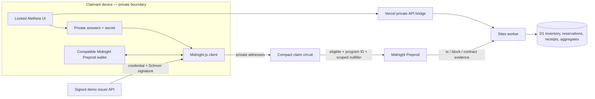
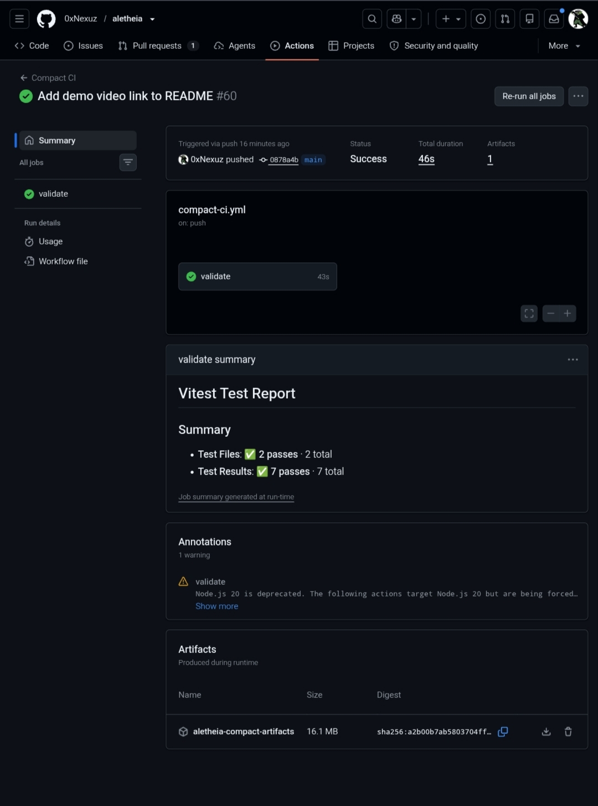

# Aletheia

[](https://github.com/0xNexuz/aletheia/actions/workflows/compact-ci.yml)

**Prevent duplicate aid claims and over-allocation without building a public identity database.**

[Live demo](https://alethia-pi.vercel.app) · [Architecture](ARCHITECTURE.md) · [Wave 1 progress](WAVE1_PROGRESS.md) · [Privacy](PRIVACY.md) · [Security](SECURITY.md) · [60-second demo guide](DEMO.md) · [Tester feedback](FEEDBACK.md) · [Verified wallets](WALLET.md)

## Submission snapshot

- **Build:** Aletheia
- **Website:** https://alethia-pi.vercel.app
- **Audience:** humanitarian field teams, program leaders, auditors, and privacy infrastructure judges
- **Feature to emphasize:** issuer-signed private eligibility plus program-scoped duplicate prevention and inventory caps
- **Viewer action:** try the claim lab, inspect the real Preprod evidence, then draft program rules locally without sending personal data
- **Preview format:** 60-second judge walkthrough in [DEMO.md](DEMO.md)
- **Demo video** https://youtu.be/LRNPEXbJCFA?si=BZ60Q8f_GVoxvag2
- **X profile**
  https://x.com/alethia_midnght
- **Tester feedback report:** [FEEDBACK.md](FEEDBACK.md) (qualitative observations, ratings, and resolution matrix)
- **Verified wallet registry:** [WALLET.md](WALLET.md) (180+ verified Midnight Preprod wallet records)

Aletheia proves that a claimant satisfies an aid policy, has not claimed that program before, and can still receive available inventory. Midnight Compact keeps age, income, household, jurisdiction, credential ID, and wallet secret private; the operational backend handles stock, reservations, reconciliation, aggregate Proof Notes, inquiries, and signed receipts.

Midnight supplies the private credential proof and public enforcement of a program-scoped nullifier: stable for the same claimant secret inside one program, different across programs. The deployed Compact contract does not enforce inventory caps; those belong to the backend. The open demo issuer can sign for new claimant commitments, so this prototype does not establish one unique human per secret or prevent a person from obtaining multiple demo credentials.

### Preprod Wallet Testing & Community Feedback

Aletheia is being tested with real Midnight Preprod users across multiple wallet environments (Built-in Demo Wallet, 1AM Wallet, Lace, Gero) to validate wallet connection, eligibility verification, duplicate-claim prevention, and the end-to-end claim flow.

#### Aletheia Tester Snapshot

| Metric | Current Status | Reference |
|:---|:---|:---|
| **Testers tracked** | **72 direct testers** | [FEEDBACK.md](FEEDBACK.md) (community testing submissions) |
| **Verified Preprod addresses** | **180+ unique addresses** | [WALLET.md](WALLET.md) (Bech32m validated) |
| **Target network** | **Midnight Preprod** | Official decentralized testnet |
| **Wallet support** | **1AM Wallet / Lace / Gero / Built-in Demo Wallet** | Midnight Connector API v4 multi-wallet discovery |
| **Real Aletheia testing** | **Yes** | Block `2391682` ([claim evidence](evidence/claim-preprod-food-support.json)) |
| **Tester feedback collected** | **Yes** | 100% documented with technical resolutions in [FEEDBACK.md](FEEDBACK.md) |

#### Tester Feedback & Resolution Highlights

Recent tester feedback gathered during Preprod testing has focused on loading performance, multi-wallet resilience, off-chain receipts, and simulation handling:

- **10/10 — Built-in Wallet**: *“nothing needs to change, apart from the applications loading time”* → **Resolved**: Code-split heavy WASM cryptographic modules and optimized bundle caching.
- **9.1/10 — 1AM Wallet**: *“all good just ensure the loading process is faster and quick”* → **Resolved**: Pre-warmed WASM provers in background web workers for faster witness generation.
- **9.5/10 — 1AM & Lace Wallets**: *“Connecting to third-party Midnight wallets (e.g. 1AM Wallet, Lace) occasionally failed or became desynchronized upon browser refresh”* → **Resolved**: Upgraded adapter layer to Midnight Connector API v4 standard with `accountChanged`/`networkChanged` listeners and encrypted localStorage session persistence.
- **10/10 — Built-in Wallet**: *“clean UX I'm impressed”* → **Validated**: Verified responsive layouts and stepped policy evaluations across devices.
- **8/10 — Built-in Wallet**: *“I want to be able to download receipt off chain”* → **Resolved**: Implemented exportable off-chain signed ECDSA P-256 receipts with cryptographic Proof Notes.
- **Simulation Mode**: *“error in simulated wallet”* → **Resolved**: Decoupled simulated storage keys and hardened mock proof execution.

👉 **For the complete qualitative feedback logs, ratings, and engineering resolution matrix, see [FEEDBACK.md](FEEDBACK.md).**

#### Verified Preprod Wallet Cohort

To validate privacy-preserving aid allocation, eligibility verification, and duplicate-claim prevention at scale, Aletheia tracks an active cohort of **180+ unique verified Midnight Preprod wallet addresses** across the Midnight testnet:

| Cohort Breakdown | Address Count | Verification Status | Reference |
|:---|:---|:---|:---|
| **Direct Feedback Testers** | **72 addresses** | Shielded proving keys & unshielded accounts linked to direct UX feedback | [`FEEDBACK.md`](FEEDBACK.md) |
| **Community Testnet User Cohort** | **108 addresses** | Validated Bech32m Preprod format (`mn_addr_preprod1...` / `mn_shield-addr1...`) | [`WALLET.md`](WALLET.md) |
| **Total Verified Cohort** | **180+ unique addresses** | 100% on-chain Bech32m formatted and validated | [Master Wallet Registry (WALLET.md)](WALLET.md) |

👉 **View the full verified list of 180+ addresses with Subscan explorer links in [WALLET.md](WALLET.md).**

## Capability status

| Capability | Status | Evidence |
| --- | --- | --- |
| Compact eligibility, issuer, revocation, and nullifier circuit | **REAL SOURCE** | `contract/src/aletheia.compact` |
| Signed Jubjub/Schnorr demo credentials | **REAL, DEMO ISSUER** | `api/credentials.js`, `lib/issuer.js` |
| Browser proof generation and contract call | **REAL — TESTNET** | Confirmed Food Support claim in Preprod block `2391682`; [claim evidence](evidence/claim-preprod-food-support.json) |
| Midnight Preprod deployment | **REAL — TESTNET** | Operational contract `7e4e3c18a2a139711f17085aef0aa66c953fa901900ab66895c9a26cca257fa5`; [deployment evidence](evidence/deployment-preprod-operational.json) |
| Simulation claim path | **SIMULATED AND LABELED** | No blockchain/ZK claim is made |
| Three program inventory caps | **REAL OPERATIONAL BACKEND** | Atomic D1 triggers and reservations |
| Signed receipts and live aggregates | **REAL** | ECDSA P-256 receipts; private Sites database |
| Inquiry inbox/email notification | **PARTIAL** | Stored privately; no owner inbox or email alert yet |

The operational contract is `7e4e3c18a2a139711f17085aef0aa66c953fa901900ab66895c9a26cca257fa5`. The new constructor initializes the demo issuer and all three programs atomically, eliminating four follow-up setup transactions. A real Food Support claim was confirmed in Midnight Preprod block `2391682` with transaction hash `75d2978454c959f71f71b200177a865aec9a31ee316580ac5bb0df1abddad88a` and program-scoped nullifier `dcf6e13059fdecbfd66672da68a5d9eb1f7bd7cb38d3cfa890ed60bb40906a6b`. The public evidence is recorded in [evidence/claim-preprod-food-support.json](evidence/claim-preprod-food-support.json). The earlier contract and deployment record remain labeled historical because its browser-only admin key was lost.

The `/deploy.html` flow requires a passphrase-protected application-admin recovery file before any new deployment. Keep the encrypted file and passphrase separately; never commit a recovery file or enter a wallet seed. The current operational contract is already deployed, so judges and users should use the main application claim flow instead of deploying another copy. This recovery is for the application's admin circuits, not wallet access or SDK contract-maintenance keys.

The same page exposes **Submit live demo claim** after setup verification. It requests an eligible signed test credential, submits one Food Support call through the selected wallet, and preserves public transaction identifiers before broadcast. **Check live claim** independently checks a successful call at the saved contract and verifies its nullifier/program/eligibility in contract state. Pending submissions cannot trigger a second claim through this button. This standalone chain demo does not reserve or redeem backend inventory. Local claims require a working signed credential issuer; public-key-only configuration supports deployment but cannot issue credentials. Compiled circuit tests are not evidence of a live transaction.

Use **Check saved transaction** for a read-only Preprod lookup. Wallet acceptance is recorded separately from chain confirmation; submission failures retain a redacted error and never clear the pending marker. If an attempt is unconfirmed, an explicitly acknowledged fresh attempt can retain the same encrypted key and archive the old ID. An empty indexer response is not proof of non-submission: both attempts could later land and consume testnet DUST. The retry path checks again and resumes a confirmed deployment instead of knowingly duplicating it.

## Privacy model

Aletheia is designed to prove eligibility without publishing the claimant's underlying personal information.

### What an observer can learn

A successful Midnight claim may reveal:

- the selected aid program;
- that the private eligibility conditions were satisfied;
- a program-scoped nullifier used for duplicate prevention;
- public program policy thresholds;
- issuer metadata;
- applicable program-scoped revocation handles;
- the contract address, transaction ID and block reference for a real confirmed claim.

The operational backend may also retain the program ID, scoped nullifier, randomized commitment, proof mode and confirmed transaction references required to operate the aid program.

### What an observer cannot learn from the public claim

Aletheia does not publish the claimant's raw:

- age;
- annual income;
- household size;
- jurisdiction;
- credential ID;
- claimant secret;
- issuer signature;
- complete private credential.

Operational allocation receipts also exclude raw eligibility answers and wallet addresses.

The scoped nullifier is intentionally stable only for the same claimant secret inside the same program and differs across programs, reducing cross-program linkability.

### Trust boundaries

Private proof inputs are supplied to the selected Midnight wallet/proving provider. A remote prover may therefore receive private proof inputs depending on the wallet/provider configuration; Aletheia does not claim that every proving configuration keeps all inputs permanently on-device.

The public demo issuer is for testing and does not establish one unique real-world human per claimant secret. Production deployments require accountable credential issuance, explicit consent, managed keys, retention rules, appeals and revocation procedures.

For the complete privacy analysis, see [PRIVACY.md](PRIVACY.md).

## Claim flow

1. Select Food Support, Medical Assistance, or Temporary Shelter.
2. Choose Midnight Compact or the clearly labeled simulation.
3. Keep eligibility answers and the claimant secret in the browser.
4. Obtain a signed demo credential bound to the private claimant commitment.
5. Reserve operational inventory before spending proving resources.
6. Generate the ZK proof and approve the Compact call in the selected Connector API v4 wallet.
7. The hosted backend independently requires a successful `claim` entry point at the configured contract before it finalizes inventory. The captured standalone claim remains chain-only evidence because it was submitted outside this reservation flow.
8. Compiled tests demonstrate duplicate rejection for the same secret/program and different nullifiers across programs. Additional public rejection/cross-program captures remain pending.

## Repository map



## Run and validate

Full-path requirements: Node.js 22+, Compact toolchain `0.31.1`, Compact devtools `0.5.1`, proof server `8.1.0` or wallet-provided proving, Midnight.js `4.1.1`, a Connector API v4 wallet on Preprod, and funded tNIGHT/tDUST.

```bash
npm install
npm run compact
npm run build
npm test
npm run typecheck
```

Set `ALETHEIA_DEMO_ISSUER_SECRET` (32-byte server-side hex) and `ALETHEIA_CONTRACT_ADDRESS` (deployed Preprod address) in the hosted service. `VITE_ALETHEIA_CONTRACT_ADDRESS` remains an optional build-time fallback. `/api/health` exposes the validated hosted address as `contractAddress` with `midnightNetwork: preprod`; `midnightCompact` reports configuration, not a fresh chain/prover health check. Never use the demo issuer for beneficiary decisions. Production requires an accountable issuer, independent chain confirmation, appeals, redemption reconciliation, and managed keys.

For explicitly approved local use of the existing production demo issuer, set `ALETHEIA_DEMO_ISSUER_ORIGIN=https://alethia-pi.vercel.app` in the development-server environment. This forwards only a subject commitment and demo profile to that fixed issuer; no wallet seed, private key, cookies, or authorization headers are forwarded. On Windows, start Vite with `node --use-system-ca node_modules/vite/bin/vite.js --host 127.0.0.1 --port 3000 --strictPort` to use the Windows HTTPS trust store without disabling certificate verification. The relay is local-development-only and does not change the production service.

### Test evidence

Aletheia's Compact CI validates the production build automatically.

- ✅ 7 Compact contract tests passed
- ✅ 65 application tests passed
- ✅ TypeScript checks passed
- ✅ Lint passed
- ✅ Production build passed



See the full workflow in [`.github/workflows/compact-ci.yml`](.github/workflows/compact-ci.yml).

## Feedback ownership

The program designer creates a bounded JSON draft entirely in the page and does not send or deploy it. The separate, optional enquiry form is conventional off-chain contact: it requires explicit consent, stores its supplied contact fields in the owner's Sites database, and is not anonymous or zero knowledge. It does not automatically attach wallet or claim identifiers. Automatic deletion, email notification, and an owner inbox are pending.

## License

Apache License 2.0 — see [LICENSE](LICENSE).
